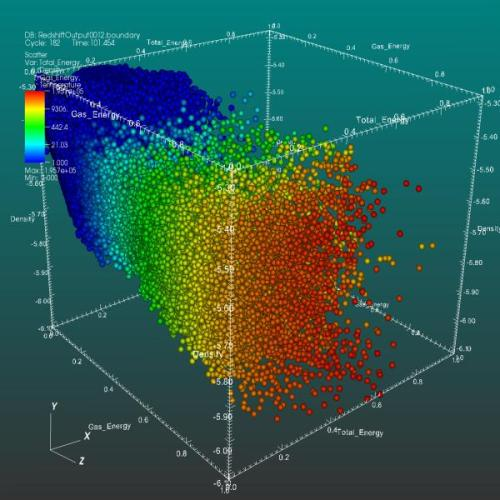

{fig-alt="A multivariate scatter plot rendered with VisIt, with colored data points in three dimensions"}

*Image credit:* UCRL / Lawrence Livermore National Laboratory, [Scatter plot](https://commons.wikimedia.org/wiki/File:Scatter_plot.jpg), rendered with VisIt; public domain in the United States ([Public Domain Mark 1.0](https://creativecommons.org/publicdomain/mark/1.0/)); cropped and resized.

**Event:** [The 57th ACSP Annual Conference](http://www.acsp.org/default.asp?page=ConfACSP) · **When:** October 13, 2017, 10:15 a.m. · **Where:** Denver, Colorado

**Abstract.** Previous applications in the urban planning field heavily lean toward the artificial intelligence approach for developing decision support systems (for example, Tanic et al. 1986 and Silva et al. 2004). In this paper, I first define and introduce the two approaches to data analysis (what), and explain why/where both approaches have their appeal. I then demonstrate when and how each approach has its strength and weakness through two case studies with real data. In the first case study, I show that imputing missing data for the National Household Travel Survey with machine learning techniques enables more robust regression analysis while capturing the uncertainties introduced in the imputation process. In the second case study, again with the NHTS data, I show how machine learning algorithms facilitate variable selection and consideration of non-linear and interaction effects, which can help inform estimations of regression models, and when machine learning techniques can replace or complement statistical models. Through a review of the development of machine learning methods and their applications in social science and two case studies with actual data commonly used in transportation research, I hope to show the value of machine learning to planning researchers.

## Slides

[Open the slides](https://hotdeck.github.io/acsp2017/) in a new tab.

<iframe src="https://hotdeck.github.io/acsp2017/" title="Statistical Models vs Machine Learning slides" width="100%" height="560" loading="lazy" allowfullscreen></iframe>
